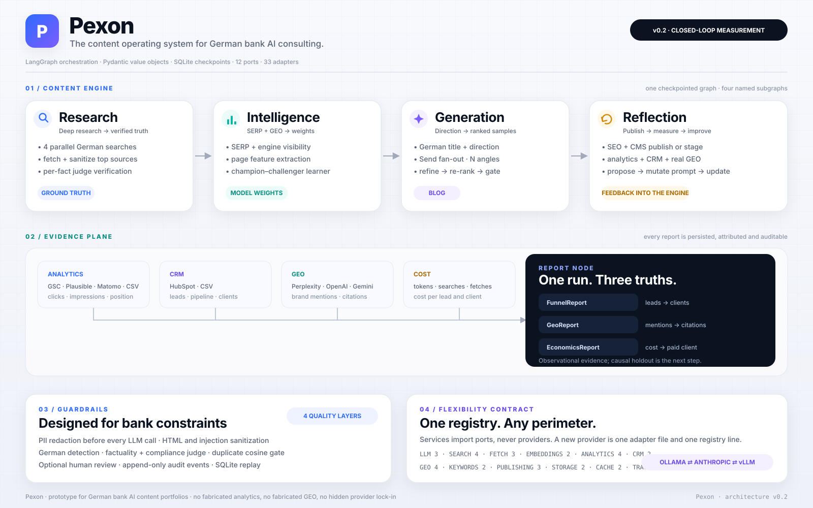
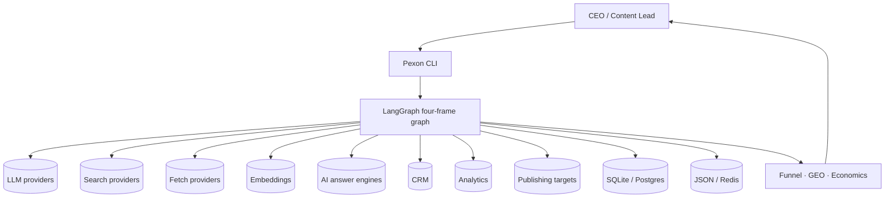
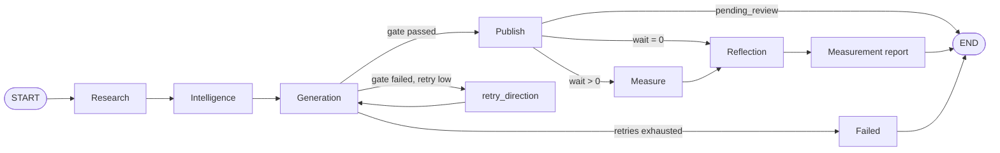
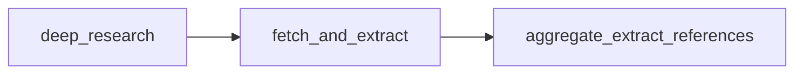
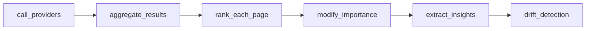
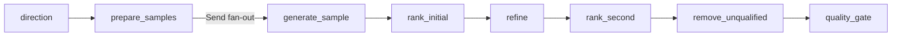
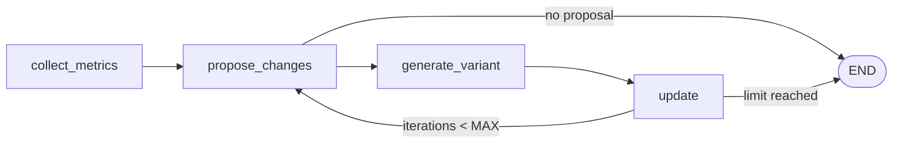

# Architecture

> Four frames, one checkpointed LangGraph, a provider-independent adapter layer, and a
> measurement plane that treats business outcomes as first-class data.



## 1. Design goals

Pexon is a prototype, but it is deliberately architected as if it could become an
internal bank platform:

1. **Four named frames.** Research, Generation, Intelligence and Reflection exist as
   separate LangGraph subgraphs and separate services.
2. **Strict dependency direction.** `graph → services → ports ← adapters`; models have
   no dependencies.
3. **One flexibility contract.** Adding a provider is one adapter file plus one
   registry line. No service, graph or subgraph changes.
4. **Evidence over claims.** A metric without a real source is reported as unmeasured,
   never synthesized.
5. **Auditability.** Every run, retry, gate, publication, measurement, prompt mutation
   and model promotion is recorded.
6. **Depth, not sprawl.** The complexity budget is spent on learning, calibration,
   guards, replay and measurement.

## 2. System context



The graph is the only orchestrator. Services contain domain logic. Ports are stable
interfaces. Adapters own provider-specific code.

## 3. Top-level graph



Compiled in [src/pexon/graph/pexon_graph.py](../src/pexon/graph/pexon_graph.py) with a
SQLite checkpointer. The `run_id` is also the LangGraph `thread_id`.

### Why a single parent graph?

Subgraphs remain independently testable and independently replaceable, while the parent
owns the business sequence and the retry/measurement control flow. A failure in one
frame is visible as a graph transition, not hidden inside a function call.

## 4. The four frames

### 4.1 Research



- `RESEARCH_QUERY_COUNT` real German queries run in parallel.
- `SEARCH_FALLBACK_CHAIN` is walked on failure; every fallback is an event.
- Top `FETCH_TOP_N` pages are fetched and sanitized.
- A structured LLM call extracts facts, quotes and references.
- A judge verifies each fact against the cited source text.
- Unverified facts are dropped.
- The frozen `ResearchSnapshot` is persisted to `research_snapshots` and
  `.cache/research_<hash>.json`.

Source: [research_service.py](../src/pexon/services/research_service.py).

### 4.2 Intelligence



- SERP queries and engine-persona answers run concurrently.
- Deduplication is exact URL, then embedding cosine.
- Each competitor page receives seven LLM-scored features.
- The learner fits one gradient-boosting model per target on a time-based split.
- A challenger is persisted only if it beats the champion on **both** targets.
- Isotonic calibration and residual bootstrapping produce intervals.
- Feature importances feed the refinement step.
- PSI and KS drift are logged; they never auto-refit.

Source: [intelligence_service.py](../src/pexon/services/intelligence_service.py),
[learner.py](../src/pexon/services/learner.py),
[drift.py](../src/pexon/services/drift.py).

### 4.3 Generation



- The direction call produces title, angle, audience, key points and compliance hooks.
- `Send` fans out one draft per angle.
- Each draft is scored by the champion model with calibrated CIs.
- Top samples are refined using competitor feature gaps weighted by learned importances.
- Samples whose **lower CI** misses either baseline are removed.
- The gate is two-pass: deterministic checks, then an independent judge.

Source: [generation_service.py](../src/pexon/services/generation_service.py).

#### Quality gate

Deterministic:

- German language detection;
- verified citation coverage and minimum citation count;
- DSGVO / DORA / MaRisk / AI Act terms;
- duplicate cosine against the existing corpus;
- minimum article length.

Judge:

- factuality with evidence;
- compliance with evidence;
- German fluency with evidence;
- every threshold lives in `Settings`.

A failure returns named reasons. The parent graph retries direction generation up to
`MAX_RETRIES`; after that the run is marked failed and audited.

### 4.4 Reflection and report



- Publish or stage for review.
- Collect analytics over `ANALYTICS_WINDOW_DAYS`.
- If prediction error exceeds `PROPOSE_ERROR_THRESHOLD`, ask for one concrete prompt
  change.
- Mutate the relevant German prompt variant and persist a new `prompt_variants` row.
- Give the learner another promotion attempt.
- A separate parent `report` node measures real GEO visibility and joins CRM leads,
  analytics and cost data into `FunnelReport`, `GeoReport` and `EconomicsReport`.

Source: [reflection_service.py](../src/pexon/services/reflection_service.py),
[attribution.py](../src/pexon/services/attribution.py),
[geo.py](../src/pexon/services/geo.py).

## 5. State and persistence

`PexonState` is a `TypedDict` in
[graph/state.py](../src/pexon/graph/state.py). It carries:

- run and trace identity;
- topic and research snapshot;
- competitor pages, insights and weights;
- direction, samples, ranked samples and refined drafts;
- gates, prediction and decision;
- article, performance, GEO and funnel reports;
- retry/iteration counters and errors;
- provider configuration.

### SQLite

Tables:

| Table | Purpose |
|---|---|
| `topics`, `research_snapshots` | frozen research provenance |
| `articles`, `drafts`, `predictions`, `features` | article, prediction and model features |
| `performance`, `leads`, `funnel_reports` | business measurement |
| `geo_visibility` | real AI-answer observations |
| `article_costs` | per-article unit economics |
| `weights`, `model_cards` | champion model and audit card |
| `prompt_variants` | reflection-generated variants |
| `reviews` | human approval trail |
| `content_plans` | demand-aware portfolio plans |
| `events` | append-only audit |
| `schema_version` | schema identity |

The checkpointer uses `lg_checkpoints`, `lg_blobs` and `lg_writes`. If the official
`langgraph-checkpoint-sqlite` package is installed it is used; otherwise a compatible
local `SqliteSaver` is selected. See [checkpoint.py](../src/pexon/graph/checkpoint.py).

### Replay

`pexon replay --run-id <id>` reads the same thread and streams with `None` input.
Completed nodes are not re-executed and make no LLM call. Pending nodes would resume.

## 6. Ports and the registry

Every external dependency is a small port:

| Port | Methods |
|---|---|
| `LLMPort` | generate, probe |
| `SearchPort` | search, probe |
| `FetchPort` | fetch, probe |
| `EmbeddingsPort` | embed, probe |
| `AnalyticsPort` | fetch, probe |
| `CrmPort` | fetch_leads, probe |
| `GeoPort` | measure, probe |
| `KeywordPort` | demand, probe |
| `PublishingPort` | publish, probe |
| `StoragePort` | setup, write, read, find, latest, probe |
| `CachePort` | get_json, set_json, probe |
| `TracingPort` | span, probe |

The registry maps provider names to factories:

```python
_LLM = {
    "openai-compatible": _spec("pexon.adapters.llm_openai_compatible", "OpenAICompatibleLLM"),
    "anthropic": _spec("pexon.adapters.llm_anthropic", "AnthropicLLM"),
    "gemini": _spec("pexon.adapters.llm_gemini", "GeminiLLM"),
}
```

Services never import concrete adapters. The composition root builds them once. Adding
a provider requires one adapter file and one registry entry. See
[PROVIDER_MATRIX.md](PROVIDER_MATRIX.md).

## 7. Learning

The learner:

1. loads `(features, clicks, impressions)` pairs from `features` + `performance`;
2. sorts by article creation time;
3. takes the last `TRAIN_TEST_SPLIT` as test;
4. fits two `GradientBoostingRegressor`s (scikit-learn when present, a real local
   implementation otherwise);
5. calibrates on training residuals with isotonic regression;
6. bootstraps residuals for confidence intervals;
7. compares test MAE with the champion;
8. promotes only if both targets are better by `CHAMPION_MIN_DELTA`;
9. writes a `Weights` row and a `ModelCard` with provider provenance.

The predictor uses `prior-v1` until the learner has enough rows. The prior is explicitly
documented and its lower bound is still compared with the baselines.

## 8. Measurement plane

### Funnel

`AttributionService` joins:

- performance rows in the window;
- CRM leads in the window;
- per-article costs.

It produces per-article rows and portfolio rates, then persists `FunnelReport` in
`funnel_reports`.

### GEO

`GeoService` runs the configured German query set against the selected real engine.
For every answer it records:

- brand mentioned;
- owned domain cited;
- citation URLs;
- answer excerpt;
- engine and model/provider.

Only real engine adapters may produce a `GeoReport` with `enabled=true`.

### Economics

`EconomicsService` converts token and call counters into a `CostBreakdown`. The cost is
stored per article at publication. The funnel report exposes cost per lead, qualified
lead and client.

## 9. Guards and observability

- PII redaction before every LLM call via `LLMGateway`.
- HTML/script/comment/injection sanitization on fetched text.
- JSON extraction + Pydantic validation + one corrective retry.
- Structured JSON logs with a per-run `trace_id`.
- Metrics for LLM calls/tokens, search, fetch, gate failures, retries, fallbacks.
- Append-only `events` records.
- Optional LangSmith tracing.
- Optional human review staging.

## 10. Failure semantics

| Failure | Behaviour |
|---|---|
| One search provider fails | Try the next provider; emit event |
| All search providers fail for one query | Drop that query; continue other queries |
| One page fetch fails | Drop page; continue |
| One fact unverified | Drop fact; continue |
| One sample fails | Log; other samples continue |
| Gate fails | Retry direction up to `MAX_RETRIES` |
| Judge unavailable | Gate fails; no silent pass |
| Embedding unavailable for duplicate check | Duplicate gate fails |
| GEO engine unavailable | No report; event; run continues |
| CRM unavailable | Funnel report fails; event; run continues |
| Review required | Article staged; graph ends before measurement |
| Replay completed run | No re-execution |

## 11. Deliberate non-goals

- no auth or multi-tenancy;
- no Docker or Kubernetes;
- no CI workflow;
- no Alembic migrations;
- no Prometheus/Grafana/OTel;
- no queue or event bus;
- no automatic causal claims;
- no mock provider in the production path.

## 12. Decision records

- [ADR 0001 — four frames](adr/0001-four-frames.md)
- [ADR 0002 — registry](adr/0002-registry.md)
- [ADR 0003 — measurement layer](adr/0003-measurement-layer.md)
- [ADR 0004 — human review](adr/0004-human-review.md)
- [ADR 0005 — no mocks](adr/0005-no-mocks.md)
