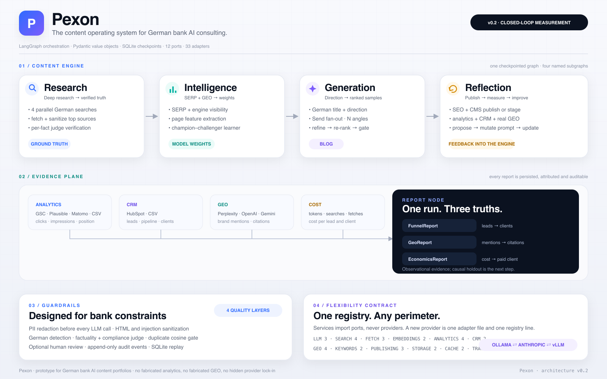

# Pexon — CEO brief

## Executive summary

Pexon is a working prototype for a **content operating system** aimed at German banks
and their AI-governance agendas. It is not a blog generator with a dashboard. It is a
four-frame LangGraph system that researches, writes, gates, publishes, measures and
learns.

The strategic premise is simple:

> **A consulting firm does not need more content. It needs content that compounds search
> visibility and AI citations into qualified conversations.**

Pexon makes that premise measurable. It joins search analytics, CRM outcomes, real AI
answer-engine visibility and unit economics into one operating loop.

## The problem

Most content programmes report activity:

- articles published;
- impressions;
- keyword rankings;
- “engagement”.

The CEO needs a different set of answers:

1. Which topics are worth writing?
2. Did the article earn search visibility?
3. Did AI assistants mention or cite us?
4. Did the reader become a lead?
5. Did the lead become a client?
6. Did the economics work?

A conventional content stack cannot answer questions 3–6 without manual stitching.
Pexon treats those questions as first-class data contracts.

## The four-frame thesis

| Frame | What it does | Why it matters commercially |
|---|---|---|
| **Research** | Finds sources, extracts facts, verifies each claim against the source | High-stakes credibility; fewer hallucinated claims |
| **Intelligence** | Studies SERPs and AI-answer behaviour, learns which page features drive performance | Content decisions are evidence-based, not taste-based |
| **Generation** | Creates multiple German angles, ranks them, refines against gaps, gates them | High quality at portfolio scale, with explicit retry economics |
| **Reflection** | Publishes, measures outcomes, proposes prompt changes, updates the learner | The system improves with each measured article |

The four frames are separate LangGraph subgraphs and separate services. That is a
deliberate business decision: a frame can be replaced, audited or scaled without
rewriting the others.

## What is now measured

| Outcome | Source | Report |
|---|---|---|
| Impressions, clicks, position | GSC, Plausible, Matomo, CSV | `FunnelReport` |
| Leads, qualified leads, clients | HubSpot or CSV CRM | `FunnelReport` |
| Brand mentions and citations in AI answers | Perplexity, OpenAI web search, Gemini grounding | `GeoReport` |
| Pipeline and won value | CRM values | `EconomicsReport` |
| Cost per article, lead, qualified lead, client | token/search/fetch counters + configured rates | `EconomicsReport` |
| Content plan priority | keyword volume, intent, funnel stage, difficulty, coverage | `ContentPlan` |

## What makes the architecture credible

### 1. Provider independence

The same services run against a laptop stack (Ollama + DuckDuckGo + CSV) and a bank
perimeter (Anthropic/vLLM + Tavily + GSC + HubSpot + Postgres). Only environment
variables change.

This matters commercially because it enables:

- a low-cost pilot;
- a self-hosted bank deployment;
- provider A/B tests without code changes;
- protection against vendor lock-in.

### 2. Real evidence, not vanity metrics

The content gate is based on clicks and impressions because those are the signals the
generator can influence before publication. But the business report is based on leads,
clients and revenue. A high-traffic article with zero qualified leads is visible as a
business failure.

### 3. GEO is measured, not role-played

The Intelligence frame still uses LLM “engine personas” for competitive research. That
is useful, but it is **not** reported as GEO. Real GEO measurement is a separate port
with adapters for Perplexity, OpenAI web search and Gemini grounding. It records brand
mentions and owned-domain citations.

If no real engine is configured, `GEO_PROVIDER=none`. The system reports that it did
not measure GEO. It does not fabricate a citation.

### 4. Human control

`REQUIRE_HUMAN_REVIEW=true` stages every article under `content/pending/` until a named
reviewer approves it. The approval is recorded in the `reviews` table and the article is
only then published. A bank deployment should enable this and pair it with legal
sign-off.

### 5. Auditable learning

- every run has a `trace_id` and checkpointed state;
- every event is append-only;
- every model has a model card with MAE, R², features, known limits and provider
  configuration at training time;
- every replay uses the same thread and does not call the LLM again for completed nodes.

## What is not yet proven

This is the part a CEO should hear directly.

Pexon currently provides **observational** evidence. It can show that traffic, citations,
leads and clients moved together in a period. It does not prove that a specific article
caused a specific client.

To prove causality, the next pilot needs:

1. a holdout set of matched topics or markets that are deliberately not published;
2. consistent CRM hygiene and article-level attribution;
3. a pre-registered measurement window;
4. a difference-in-differences or matched-market analysis;
5. a decision rule for scaling, refreshing or stopping topics.

The architecture is ready for this because the measurement surface already exists.
The causal layer itself is not implemented.

## A 90-day validation plan

No revenue numbers are assumed here. The plan is designed to produce evidence, not a
story.

### Days 0–14 · baseline

- connect GSC, CRM and (optionally) a real GEO engine;
- import 50–100 real keyword-demand rows;
- establish baseline search and AI-answer visibility for the target clusters;
- agree the qualified-lead definition with sales.

### Days 15–45 · first cohort

- publish 15–25 high-intent articles from `pexon plan`;
- require human review;
- measure every article after 28 days;
- track cost per article and cost per lead.

### Days 46–75 · learning loop

- let the learner train once `MIN_TRAINING_ROWS` measured articles exist;
- compare champion and challenger on a time-based test split;
- review prompt variants and content gaps;
- detect drift and content decay.

### Days 76–90 · causal pilot design

- choose matched topic clusters for treatment and holdout;
- freeze the assignment;
- define the primary outcome: qualified leads, not clicks;
- decide whether to scale, narrow or stop.

## Operating model

| Role | Responsibility |
|---|---|
| CEO / sponsor | Owns the north-star metric and pilot decision |
| Content lead | Owns topic portfolio, brand voice and review queue |
| Compliance / legal | Reviews regulated claims before publication |
| Growth / sales | Owns CRM stages, lead qualification and attribution |
| Engineering | Owns provider configuration, audit and reliability |

## Decision requested

Fund a **measurement-first content pilot**, not a volume-first content factory.

The pilot should be judged on:

- qualified leads per 10 published articles;
- AI-engine citation rate for the target query set;
- cost per qualified lead;
- share of articles that clear the quality gate on the first attempt;
- whether the learner beats the prior on a real test set.

If those numbers do not move, the architecture makes that visible early. That is the
point.

## Further reading

- [Architecture](ARCHITECTURE.md)
- [KPI model](KPI_MODEL.md)
- [Security and compliance](SECURITY_AND_COMPLIANCE.md)
- [Demo guide](DEMO.md)
- [Roadmap](ROADMAP.md)
