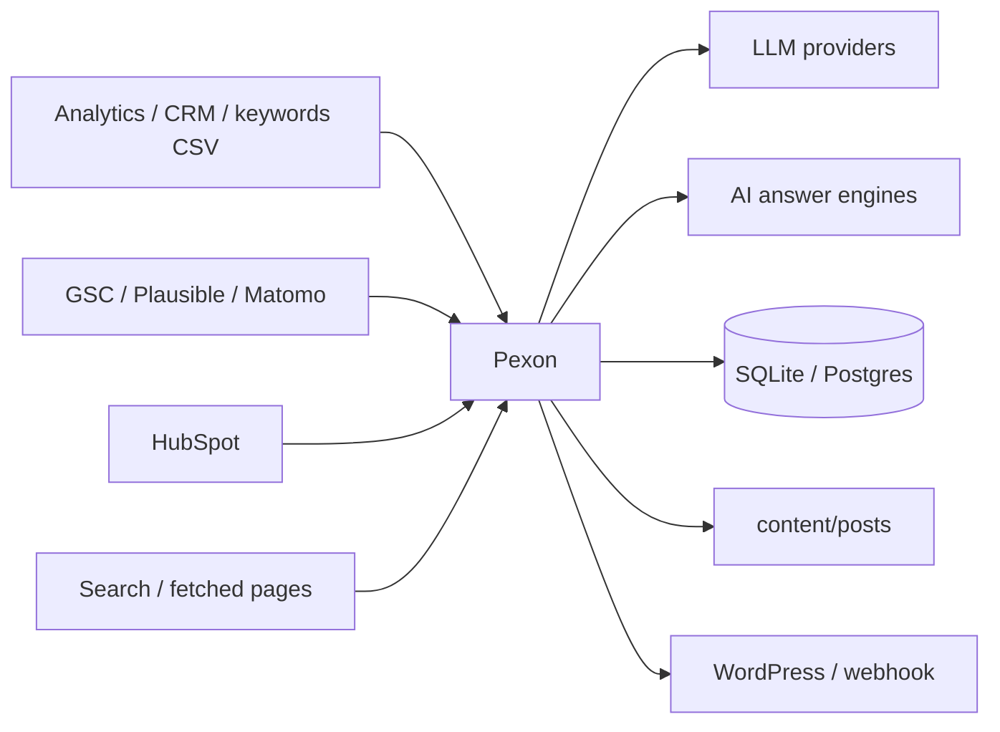

# Security and compliance

> This document describes the prototype's controls and the work a bank deployment still
> needs. It is not legal advice and does not certify DSGVO, DORA, MaRisk or AI Act
> compliance.

## 1. Scope

Pexon is a content architecture prototype. It has no authentication, user management or
multi-tenancy. It should run on a trusted workstation or behind an internal gateway.

A production bank deployment needs at minimum:

- authenticated access and role separation;
- network egress controls;
- secrets management;
- legal review workflow;
- retention and deletion policy;
- incident response;
- audit export;
- vulnerability management.

## 2. Data flows



The application sends prompts, source excerpts and draft text to the selected LLM and
judge provider. A bank that cannot send source material to a public model should use
an in-perimeter vLLM/LiteLLM endpoint via `LLM_PROVIDER=openai-compatible` and
`LLM_BASE_URL`.

## 3. Secrets

- All secrets live in environment variables or `.env`.
- `.env` is gitignored; `.env.example` contains no real keys.
- `pexon inspect settings` masks keys, tokens, passwords and secrets.
- `provider_config` persisted in model cards contains providers, models and base URLs,
  not API keys.
- Do not put credentials in URLs; use the dedicated key fields.

## 4. PII

`guards/pii.py` runs before **every** LLM call through `LLMGateway`:

- email addresses;
- IBANs;
- phone numbers;
- configured public-figure names.

Redaction counts go to metrics. The CRM adapter does not request or store email
addresses. CSV lead columns deliberately exclude email.

A bank deployment should extend the redaction list with its own DLP patterns and decide
whether company names are personal data in its context.

## 5. Prompt injection and untrusted content

`guards/sanitize.py` removes:

- scripts, styles, iframes, forms and embedded objects;
- HTML comments;
- configured prompt-injection phrases;
- control characters.

Every removed pattern is counted and the research step logs an event when text was
sanitized. Do not treat fetched web content as trusted instructions.

## 6. Hallucination and factual control

- Research facts require a source URL and a verbatim quote.
- A judge verifies each fact against the source text.
- Unverified facts are dropped.
- The article gate checks citation coverage.
- The judge returns `score` and `evidence` per dimension.
- A human review step can be required before publication.

None of this replaces legal or editorial review. The gate is a control, not a warranty.

## 7. Compliance gate

The deterministic gate checks for configured keywords:

```text
DSGVO, DORA, MaRisk, AI Act
```

That is a **presence check**, not a legal analysis. It exists to force the writer to
address the regulatory context. Legal sign-off remains human.

## 8. Human review

Set:

```dotenv
REQUIRE_HUMAN_REVIEW=true
```

The graph stages the article in `content/pending/` and stops. `pexon approve` records:

- article ID;
- reviewer;
- decision;
- notes;
- timestamp.

Only after approval does the article move to `content/posts/`, update the sitemap and
become eligible for measurement. A bank should restrict `approve` to an authorised role.

## 9. Audit

Append-only events include:

- provider failures and search fallbacks;
- fetch failures;
- dropped facts;
- every gate result and reason;
- retries;
- publication/staging;
- analytics and GEO measurement;
- proposals and prompt variants;
- model promotions/rejections;
- review approvals.

Model cards record provider configuration at training time. Checkpoints allow replay
without re-running completed nodes.

## 10. Provider risk

| Provider class | Risk | Control |
|---|---|---|
| Public LLM | data leaves perimeter | use internal vLLM/LiteLLM; redact PII |
| Public search | query leakage | use approved provider; avoid confidential terms |
| Public GEO engine | query leakage | use only public topic queries |
| HubSpot | CRM access | least-privilege private app token |
| WordPress | publishing rights | dedicated application password and limited role |
| Postgres | data at rest | encryption, access control, backup |
| LangSmith | trace leakage | opt-in; disable for sensitive prompts |

## 11. Bank deployment checklist

- [ ] `REQUIRE_HUMAN_REVIEW=true`
- [ ] LLM endpoint inside the perimeter, or DPA approved
- [ ] Judge independent from generator where required
- [ ] `GEO_PROVIDER` approved or set to `none`
- [ ] `EMBEDDINGS_PROVIDER=local` if text cannot leave
- [ ] CRM token least privilege; no email fields
- [ ] WordPress app password restricted to posts
- [ ] TLS and egress allow-list
- [ ] backup and retention policy for `db/pexon.db` and `content/`
- [ ] audit export and retention
- [ ] legal review of compliance claims
- [ ] incident response contact
- [ ] no auth exposure: keep CLI behind an internal gateway

## 12. Known gaps

- no authentication or authorization;
- no field-level encryption;
- no retention automation;
- no DLP integration beyond regex PII;
- no signed audit chain;
- no SIEM/OTel export;
- no secrets manager integration;
- no formal threat model.

These are explicit prototype boundaries, not hidden assumptions.
